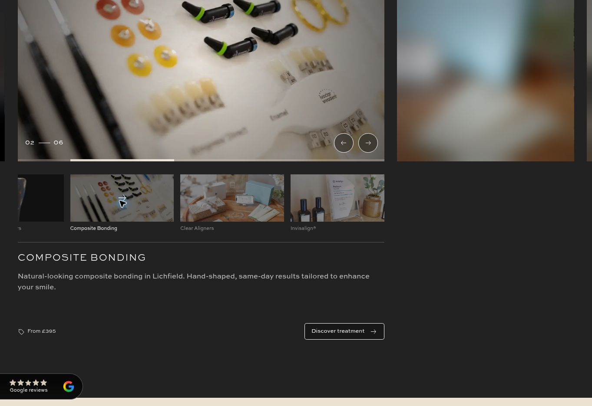

# Home control and motion ownership — 25 October 2026

Reference: [TDB Home architecture and engineering standard](https://chatgpt.com/space/page_c22eaec26d7c819197df9524f243acbd). Implements the first scope adopted by the full Home audit. Staging only; no production domains were published.

Final runtime: `8d3c3cf79502a7ca3bc27547c81eefc12610f97a`. Native page CSS: `6d573b205`. Publish task: `f828f9f9-5348-4e92-aece-6d72340ac122`.

## Result and cost

Services and Treatments now obtain their complete copy, blur and stamp transitions from the existing prepared carousel stylesheet. Designer retains geometry, artwork and simple native visibility/blur states. Global UI no longer repeats the migrated service/stamp timing rules. No loader, request, DOM element or delivered JavaScript was added.

This is primarily an ownership improvement with a small overall payload reduction. It is not evidence of a measured speed increase.

| Delivered layer | Before bytes | After bytes | Raw change | Controlled gzip change |
| --- | ---: | ---: | ---: | ---: |
| Home HTML | 184,887 | 184,887 | 0 | Publication/CMS-order noise excluded |
| Native CSS, shared + page | 215,584 | 214,110 | −1,474 | −140 |
| Shared UI CSS | 15,037 | 14,224 | −813 | −117 |
| Startup + foundation JS | 37,432 | 37,432 | 0 | 0 |
| **Tracked initial subtotal** | **452,940** | **450,653** | **−2,287** | **−257 in affected CSS** |
| Deferred slider CSS | 3,356 | 4,497 | +1,141 | +183 |
| **All affected delivered layers** | | | **−1,146** | **−74** |

Gzip is Node level 9 applied separately to the unchanged/raw files, not a claim about the CDN's encoding settings. Native shared CSS is identical. All delivered JS, deferred Vimeo CSS and other generated runtime assets are unchanged. The source/readable parallax comment was corrected to name the new owner; it contributes no delivered bytes. Documentation and this verification image are not website requests.

## Ownership and loading

| Concern | Authoritative owner | Phase / gate |
| --- | --- | --- |
| Native geometry, crops, reserved space, artwork and fallback state values | Designer | First paint, before enhancement |
| Service/treatment copy fades | `src/styles/tdb-slider-ui.css` | Existing carousel preparation; stylesheet readiness awaited before controller activation |
| Service/treatment blur transitions | Same carousel stylesheet | Same gate; use the controller's already-scaled duration, with a once-scaled 400ms fallback |
| Treatment stamp opacity and confirmation transitions | Same carousel stylesheet | Loaded before stamp initialization; 200ms fade retained through disarming |
| Hero loading, consent cancellation and spinner lifecycle | Existing early hero CSS + foundation bridge | Available before Vimeo consent; unchanged |
| Vimeo playback and buffering states | Existing deferred Vimeo module | Existing functionality-consent gate; unchanged |

The Services and Treatments controllers already share the slider loader and stylesheet readiness flag. Preparation remains at the existing 1,200px margin or interaction; no gate was widened. The loader continues to replay the first queued arrow. Native shared component instances retain the same sitewide loader contract. Simple initial visibility states remain authored so a loading failure does not alter the native page. Other native motion families and legacy/draft variant consumers were not purged by name.

Moved the complete property/duration/easing declarations from 11 native rules: three service copy phases; three treatment copy phases; service blur; treatment blur; stamp card opacity; and the stamp confirmation's two pseudo-elements. Service and treatment copy share the 200ms hidden / 400ms reveal / 150ms movement rules. Shared pace/easing tokens remain the common tuning point, and the complex selectors remain in the module sheet.

The native timing projection was regenerated from the actual published native export. Four obsolete service/stamp timing copies disappear from early UI. No layout or artwork was transferred into UI to achieve its reduction.

## Hero decision

Keep the semantic button, its two-element structure, focus treatment, entry, pulse, delayed loading reveal, cancellation and rotating fade-out. A wrapper or a new image request would not remove the lifecycle requirement.

The exact play SVG path was retained while removing unnecessary URL encoding: 848 → 684 bytes per mask value. Webflow still serializes both standard and prefixed mask properties. This compacts the artwork; **it does not eliminate the browser-prefix duplication**. The proposed local custom property was rejected by the Designer property's validator, so that alternative was not adopted. No new asset request, global artwork variable, replacement shape or extra DOM was introduced.

## Four-perspective decision

| Perspective | Assessment and challenge to the other priorities |
| --- | --- |
| LCP/startup | Initial CSS loses 2,287 raw bytes. Deferred cost must be counted too: the overall compressed saving is only 74 bytes. Do not call this a large speed gain. |
| In-page usability | Preserve the established readiness gate, replay and gesture implementation. No new listeners or frame work. Native fallback states remain available if module preparation fails. |
| Polish/readiness | Keep timings/easing, 20px blur, glyph shape, focus and hero cancellation. Moving a transition is acceptable only because its sheet is ready before the controller can trigger it. |
| Maintenance | One prepared stylesheet owns the entire transition declarations for these phases; the early timing duplicate disappears. Do not force a hero rewrite or add abstractions for tiny byte savings. |

**Chair decision:** adopt this bounded handoff and SVG encoding reduction. Preserve useful native boundaries and existing hero lifecycle. This closes the service/treatment transition transfer, not every native motion consumer. The separately scoped next item remains unchanged JSON-LD minification; IX2 removal and preparation tightening still require their own consumer evidence. Audio/Safari work remains paused.

## Verification

- Full verification: **768 passed, three existing skips, zero failed**. After the final projection regeneration, build parity and 22 motion/projection/ownership tests passed.
- Published native semantic diff is limited to the 11 intended transition owners and the hero mask encoding. No geometry or state-value change. The shared stylesheet is byte-identical.
- Source DOM remains 1,132 total / 1,096 body elements, 98 CMS items, 16 CMS lists, 93 images and 109 links. Parsed DOM is identical after excluding release/publication metadata and the existing CMS partner ordering.
- Final staging uses one release across all four entry pins. UI and slider CSS CDN bodies match their build outputs.
- Desktop browser: first service arrow advances to Signature Assessment; treatment stamp selects Composite Bonding and updates copy/confirmation; stamp and confirmation transitions remain 200ms. Visible/hidden copy is 400ms ease-in / 200ms ease-out. Active blur is 0px, inactive blur 20px, using the existing controller clock.
- Service and treatment carousel heights remain 982.796875px and 465.046875px in the same viewport. Scroll locks clear and no TDB console warnings appear.
- Hero first click requests consent without fetching Vimeo; rejection returns the play label, idle state and invisible paused spinner. Hero runtime, timing CSS and bridge are unchanged. No new full playback/fade trace or physical-phone fling acceptance is claimed.

## Rollout and rollback

First publish paired the native edits with compatible release `124569c49f6579d842f399bd54ffbb069b1cd033`, which already supplied the deferred transitions. Then the actual export was used to regenerate and remove early timing copies, and all four pins moved together to final release `8d3c3cf79502a7ca3bc27547c81eefc12610f97a`. This avoids publishing native deletions before their replacement sheet is available.

For full rollback, apply the native style and variant rollback actions in [the evidence record](home-control-motion-20261025.json), restore all four site runtime pins to `782454b4d242e7341af7df78e06a749329e33758`, and publish staging only. Restore native properties and runtime pins together; a runtime repin alone does not restore Designer declarations. Refresh provenance against the restored export. Do not publish production domains as part of rollback.
