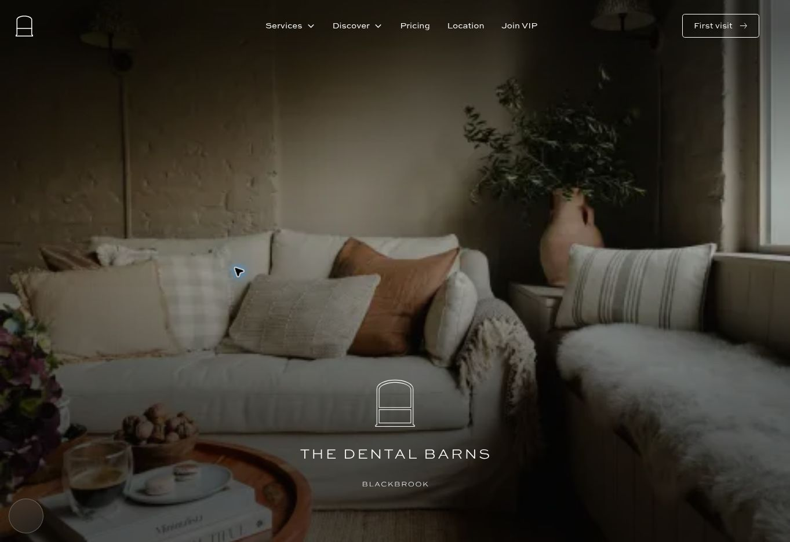

# Modular UI staging release — 13 October 2026

This release starts with the versions actually pinned on Webflow staging, including the home-page footer override. It does not upgrade unrelated runtimes to the repository's default branch.

| Owner | Contents and loading |
| --- | --- |
| `tdb-ui.css` | Shared nav/banner/VIP coordination, scrolling and Lenis, control keyframes, reveal readiness, shared focus and compatibility rules. Existing asynchronous head link. |
| `tdb-vimeo.css` | Existing video interaction states. Requested by the Vimeo loader immediately for a hero, otherwise near video or on intent. The consent-gated controller waits for both this stylesheet and shared UI. |
| `tdb-announcement.css` | Announcement runtime states and the existing narrow breakpoint. The announcement loader waits for this stylesheet and shared UI before loading its engines. |
| `tdb-slider-ui.css` | Existing slider states plus shared carousel-arrow states. Loaded near sliders or any native arrows, including review, Instagram and partner components. |
| Consent startup | Existing consent browser/accessibility helpers injected once before the consent controller opens. Designer still owns the native banner layout. |

The shared UI artifact falls from 20,065 to 6,501 bytes (67.6%); gzip falls from 4,809 to 1,786 bytes. Most removed bytes are deferred or conditional, rather than deleted from the site. Existing declarations, timings, selectors and playback/consent semantics are retained. Static formatting and initial visibility guards stay in UI where a verified Designer replacement is not available.

## Preserved source versions

- Shared UI: `47d6daccfe8b3083ab79d3adf569e0b54619ca18`.
- Consent: `2bf37d3cfc2134272e14ee51766d645fe6f40956`, including its matching native-consent test (the former font gate was already removed).
- Vimeo controller: `97349848b1d29f0c509d57551393a6e9a49f1d46`; remains explicitly pinned there.
- Slider CSS: `59a7ba5a8ed95c07d738e067e65795a3daf23c05`.
- Footer and VIP drawer: `405af73d4d62619c66bb1140ee6f1e6081b0559c`; the drawer remains explicitly pinned there.

## Checks

- `tests/ui-modular.test.cjs`: declaration preservation, feature presence/proximity, stylesheet ordering and failure recovery, denied consent, announcement dependencies.
- `tests/consent-native.test.cjs`: fresh/saved/legacy consent, categories and events, focus trap/return, close timing, rapid reopen, independent scroll-lock owners.
- `tests/vip-consent-ownership.test.cjs`: consent ownership while the VIP drawer is open at mobile and desktop sizes.
- Built JS syntax checks and `tools/runtime-build/verify-ui.cjs`.

The DOM tests use jsdom 26.1.0 and postcss 8.5.6, supplied through `NODE_PATH`; build tools are pinned in `tools/runtime-build`.

## Deployment and rollback

The Webflow site is `677cf86cf9952f978d94d80c`; home is `677cf86df9952f978d94d8a9`. Pin shared UI, consent startup, Vimeo loader, site footer runtime base, and the home footer runtime-base override to this release commit. Keep all other pins intact. Remove the old `data-tdb-vimeo-ui` attribute from shared UI and mark its load/error status for the loaders.

Publish only to `dentalbarns.webflow.io`, with an empty custom-domain list. Roll back by restoring the exact site head/footer and home head/footer strings saved in `ui-modular-before-20261013.json`, then publishing to the same staging subdomain.

## Published verification

- Asset release: `716f48d913168ce00cfcc2546fb594ebe5182ebe` on `work/ui-modular-20261013`.
- Webflow publish task: `49785576-9988-4083-ade2-89992f3398f1`; custom domains empty, Webflow subdomain enabled.
- All seven changed CDN assets matched the local tested files before publishing. Saved site/home code blocks matched their readback.
- Checked the other 43 publishable, non-draft page/template configurations for conflicting UI or runtime-base overrides; none found.
- Live homepage: Services menu opened and closed; video click opened consent without loading the player; accepting consent loaded the preserved controller and reached `playing`; VIP drawer opened with its native form and closed with Escape; Services advanced to Signature Assessment; review cards advanced from Susie to Chloe; practice-highlights drawer opened and advanced from Tranquil Location to Gold Standards.
- Announcement CSS readiness was `1` before its pending marker was removed. Carousel CSS was requested only once and its disabled-arrow states remained applied. No failed stylesheet markers or site runtime errors were observed (browser-extension metadata errors were unrelated).
- `/privacy-policy` had no video roots and requested no Vimeo stylesheet.
- Automated mobile/desktop consent ownership passed; live browser checks used the available desktop viewport. This is regression coverage, not an exhaustive check of every page on every device.

